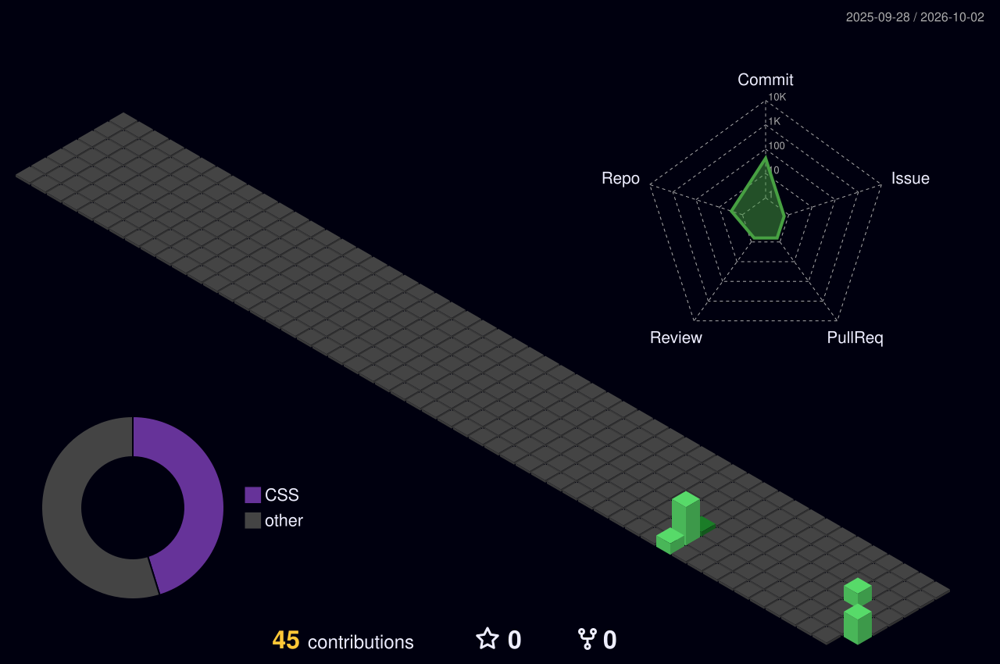

<div align="center">
  
</div>

<p align="center">
  <a href="https://github.com/ToxicStyle-DevXplorer?tab=repositories">
    
  </a>
  <a href="https://github.com/ToxicStyle-DevXplorer?tab=followers">
    
  </a>
  <a href="https://komarev.com/ghpvc/?username=ToxicStyle-DevXplorer">
    
  </a>
</p>

---

### About

Software and systems engineer focused on low-level programming, custom embedded hardware, and full-stack web applications. Interested in clean architecture, deterministic performance, and minimalist developer tooling.

- **Systems & Application Development:** Writing efficient native code in `C++`, automation and machine learning pipelines in `Python`, and responsive web interfaces with `JavaScript` and `Tailwind CSS`.
- **Hardware & Firmware:** Designing and building wireless ergonomic split keyboards (`Corne` / `nRF52840` / `ZMK`) and interactive microcontroller prototypes on `ESP32-S3`.
- **Current Focus:** Developing **SkillOrbit** (a peer-to-peer skill-sharing platform) and training autonomous reinforcement learning agents in **Godot Engine 4**.

---

### Selected Projects

<table>
  <tr>
    <td width="50%" valign="top">
      <h4>SkillOrbit</h4>
      <p>Peer-to-peer web platform enabling students to exchange technical skills with a fast, minimalist interface.</p>
      <code>HTML5</code> <code>Tailwind CSS v4</code> <code>JavaScript</code>
    </td>
    <td width="50%" valign="top">
      <h4>Autonomous RL Simulation</h4>
      <p>2D top-down simulation environment built in Godot 4 for training autonomous agents via <code>godot-rl-agents</code>.</p>
      <code>Python</code> <code>Godot 4</code> <code>Reinforcement Learning</code>
    </td>
  </tr>
  <tr>
    <td width="50%" valign="top">
      <h4>Wireless Corne Split Keyboard</h4>
      <p>Custom-built ergonomic split mechanical keyboard powered by SuperMini nRF52840 controllers and custom ZMK keymaps.</p>
      <code>ZMK Firmware</code> <code>nRF52840</code> <code>Hardware</code>
    </td>
    <td width="50%" valign="top">
      <h4>ESP32 Interactive Companion</h4>
      <p>Compact embedded device built around the ESP32-S3 featuring an OLED display interface and capacitive touch controls.</p>
      <code>C++</code> <code>ESP32-S3</code> <code>Embedded</code>
    </td>
  </tr>
</table>

---

### Technical Stack

**Languages**  


**Frameworks, Engines & Embedded**  


**Environment & Tools**  


---

### Metrics & Contributions

<div align="center">
  
  
</div>

<div align="center">
  
</div>

<br/>

<div align="center">
  <picture>
    <source media="(prefers-color-scheme: dark)" srcset="./profile-3d-contrib/profile-night-green.svg" />
    <source media="(prefers-color-scheme: light)" srcset="./profile-3d-contrib/profile-gitblock.svg" />
    
  </picture>
</div>

<div align="center">
  <picture>
    <source media="(prefers-color-scheme: dark)" srcset="./output/github-contribution-grid-snake-dark.svg" />
    <source media="(prefers-color-scheme: light)" srcset="./output/github-contribution-grid-snake.svg" />
    
  </picture>
</div>

---

<details>
  <summary><b>Workstation & Recent Activity</b></summary>
  <br/>

```text
OS        Arch Linux x86_64
WM        Hyprland (Wayland)
Terminal  Kitty + Zsh
Editor    Neovim / Cursor
Keyboard  Wireless Corne Split (nRF52840 / ZMK)
```

<!--START_SECTION:activity-->
<!--END_SECTION:activity-->

</details>
